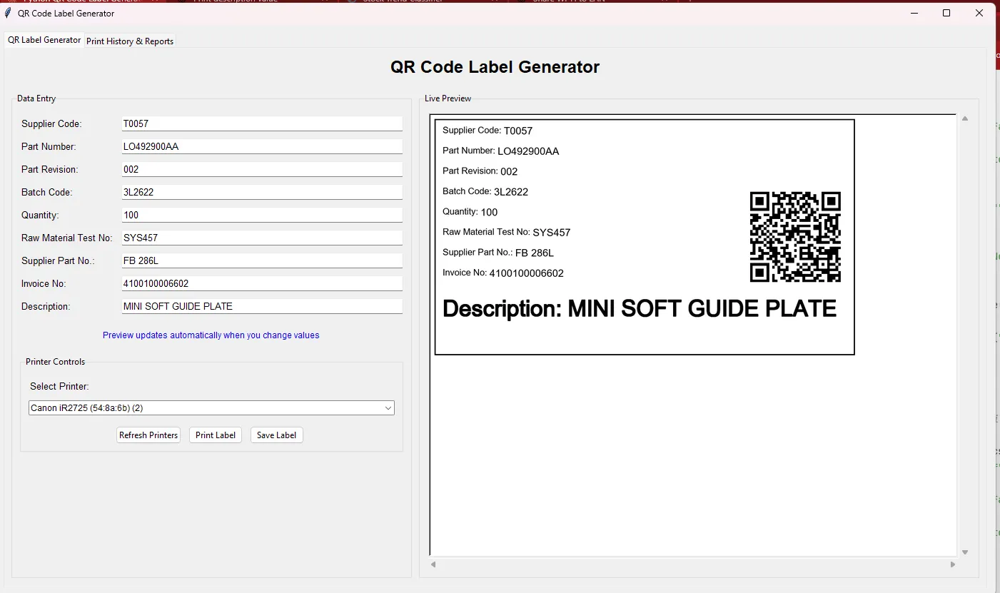

# 🏷️ QR Code Label Generator

A Windows desktop application that creates visiting-card-sized part labels with a QR code, prints them to any installed printer, and keeps a searchable print history. Built for manufacturing and supply-chain teams that need consistent, scannable part labels.

> ℹ️ This is a showcase repository. The source code is private; this page describes the features, my role and the tech used.

---

## 📸 Screenshot

---

## ✨ Features

- **Live preview** that updates as you type
- **Part label fields:** supplier code, part number, revision, batch code, quantity, raw material test number, supplier part number, invoice number and description
- **QR code** that encodes every field into a single scannable string
- **Print-ready size:** 3.5" × 2" visiting-card labels at 300 DPI
- **Printer selection** from installed Windows printers, with refresh
- **Export** labels as PNG, JPEG or PDF
- **Print history:** every print is logged automatically with a timestamp
- **Reports tab** with pagination (10 / 25 / 50 / 100 rows) and CSV export for Excel
- **Standalone .exe:** packaged with PyInstaller, so no Python install is needed on shop-floor PCs

## 🛠️ Tech Stack

- Python with Tkinter for the desktop interface
- `qrcode` and Pillow for QR and label rendering
- pywin32 for Windows printing
- PyInstaller for the single-file executable

## 👤 My role

Designed and developed the application end to end: label layout, QR encoding, printer integration, print history and reporting, and packaging as a Windows executable.

---

📫 Want to know more? See my [portfolio](https://varunvasudevan.github.io).
